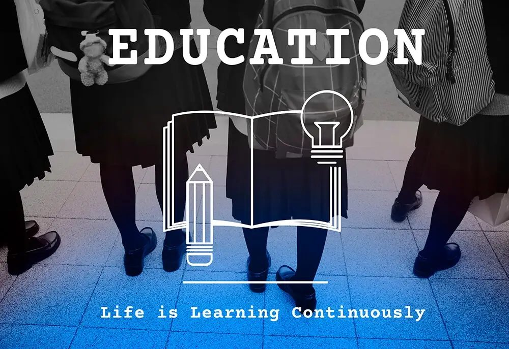
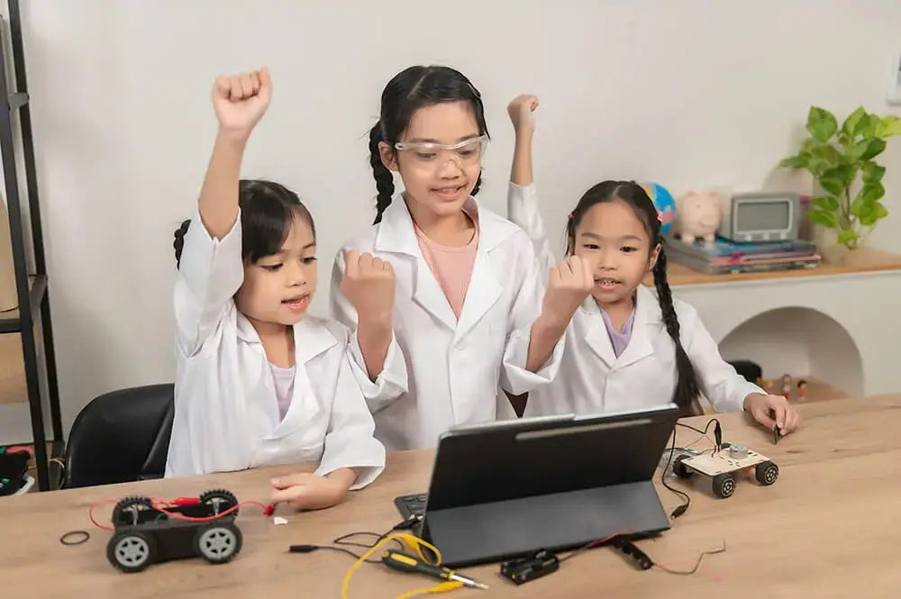
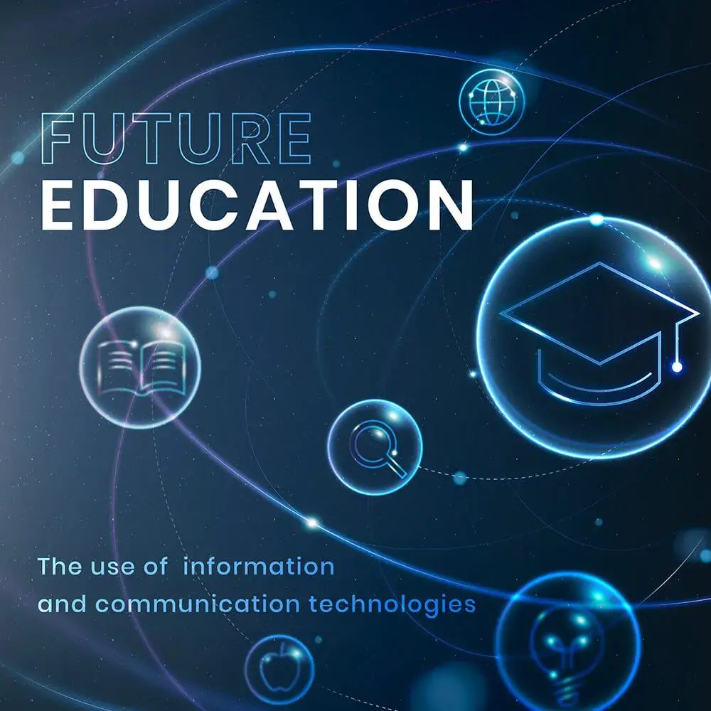
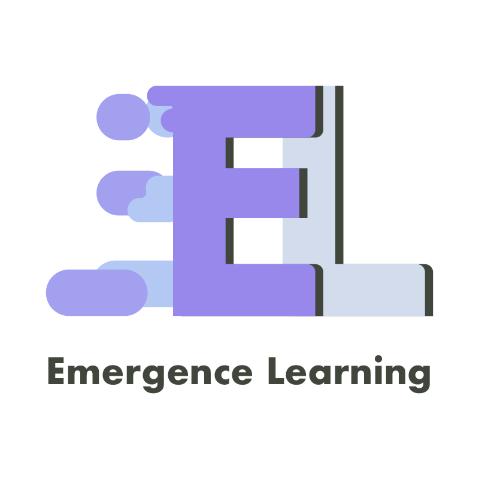

Discovering the Passion for Future-Relevant Education, Maintaining Balance, and Overcoming Challenges
Empowering Future-Driven Education- In the fast-paced world of education, where innovation and adaptability are key, one individual stands out as a beacon of hope for students seeking a personalized and empowering learning experience. We sat down with Alec Goldman, the visionary educator and founder of Emergence Learning, to learn more about his motivation, journey, and the unique approach he brings to the industry. Join us as we dive into the fascinating world of future-focused education with Emergence Learning, a groundbreaking educational platform that prioritizes empathy, critical thinking, and the cultivation of meaningful relationships.

[Inspire Members](/inspire-members/)

## **The Journey Begins: A Quest for Personalized Learning**

Growing up in a traditional school environment, Alec Goldman always longed for a return to the independent and student-driven learning he experienced during his primary years. The desire to recreate that type of environment and provide a future-relevant education sparked his journey into the world of non-traditional learning. With a strong passion for mentoring and guiding students, Goldman set out to make a real impact in the field of education.

## **Balancing Act: Finding Harmony in Work and Life**

Maintaining a work-life balance can be challenging, especially for passionate entrepreneurs and business leaders. Goldman finds solace in his faith, drawing from the concept of keeping the Sabbath as a day of rest. This not only allows for a separation from professional obligations but also provides an opportunity to reflect on what truly matters. Additionally, the presence of his entertaining feline companions brings an element of joy and distraction, adding a touch of levity to his everyday routine.

## **Overcoming Obstacles: The Path to Authenticity**

Every career has its fair share of challenges and setbacks, and Alec Goldman is no exception. For years, he felt like an outsider in a world of educators who formed deep connections with their students. However, a transformative experience prompted a shift in perspective. Through introspection and therapy, he realized the importance of embracing his true self and shedding the desire to conform. This breakthrough led him to connect with his students on a much deeper level, fostering trust and empowering them to thrive.

## **Empathy as the Key: The Foundation of Success**

In the realm of future-focused education, empathy reigns supreme. Alec Goldman emphasizes the critical role of empathy in his work. By actively listening to his students' intellectual and emotional needs, he can provide non-judgmental guidance tailored to each individual's unique journey. Coupled with a healthy sense of humor and the ability not to take himself too seriously, Goldman builds trust and creates an open environment where students can flourish.

## **Staying Ahead of the Curve: Navigating Evolving Trends**

To stay up to date with the ever-evolving landscape of education, Alec Goldman dedicates time to extensive reading and networking with other education innovators. By actively seeking out emerging trends and advancements in educational technology, he ensures his pedagogical practices remain relevant and effective.

## **Emergence Learning: Redefining the Educational Landscape**

The creation of Emergence Learning was not merely a business venture; it was the culmination of Alec's journey to realize a future-focused educational vision. By focusing on the most rewarding aspects of his previous start-up, he seized the opportunity to found Emergence Learning, a school that embodies his core values. What sets Emergence Learning apart from its competitors is its unwavering commitment to empathy and critical thinking. Every aspect of the student's learning journey is rooted in building trusting relationships and valuing each stakeholder. This approach provides a stark contrast to traditional schools that may have left students feeling marginalized and excluded.

## **A Proud Achievement: Transforming Lives through Personalized Learning**

Within Emergence Learning, there is a remarkable success story that Goldman holds close to his heart. He recounts a student on the Autism Spectrum who had been expelled from multiple schools and struggled to pass classes. However, through patient guidance and mentorship, the student began to gain confidence and embark on a transformative journey. Now on the path to earning a GED, this student is discussing potential university options and career paths in the gaming industry. Their progress serves as a testament to the power of personalized learning and the positive impact it can have on individual lives.

## **Fostering Innovation: Student Empowerment and Collaboration**

Innovation and creativity thrive within Emergence Learning. Goldman actively encourages suggestions and ideas that enhance the connection between students and their learning experience. By valuing student input and involving them as part of the team, Emergence Learning cultivates a sense of ownership in their education. This shift empowers students to become self-directed learners, ultimately shaping their own futures.

## **Making Difficult Decisions: Embracing Strengths and Weaknesses**

Acknowledging strengths and weaknesses is essential for personal and professional growth. Goldman has come to terms with the fact that while he excels as an educator and mentor, the business side of things is not his forte. Recognizing this, he made the decision to seek a partner who can handle the business aspects, allowing him to focus on what he does best—making a profound impact on students' lives and expanding his reach.

## **Nurturing Relationships: Communication and Trust**

Building long-lasting relationships with families and clients is paramount for Alec Goldman. Through open and honest communication, he ensures that promises made are promises kept. By addressing concerns and issues promptly, he prevents dissatisfaction from festering and maintains strong, trusting relationships with students and their families.

In a world where education is undergoing a rapid transformation, Alec Goldman of Emergence Learning stands as a beacon of hope, championing a future-relevant approach rooted in empathy, critical thinking, and personalized learning. With Emergence Learning paving the way for a new paradigm in education, Alec Goldman's innovative methods continue to empower students and reshape their futures.

As we conclude our conversation, we are left inspired by his journey and the immense impact he has made. The legacy of this visionary educator will undoubtedly continue to shape the lives of countless students, helping them navigate the ever-changing landscape with confidence, purpose, and resilience.

In the realm of education, Alec at Emergence Learning stands out as an innovative and empathetic educator. His journey has been driven by a passion for personalized learning, fostering deep connections with students, and creating a future-relevant education experience. Through his dedication to empathy, critical thinking, and the cultivation of meaningful relationships, Alec has transformed the lives of numerous students, empowering them to thrive in a rapidly evolving world.

At Emergence Learning, Alec's vision comes to life, offering a unique educational approach that sets it apart from traditional schools. With a core focus on empathy and critical thinking, Emergence prioritizes the individual needs and aspirations of each student, ensuring a personalized learning journey that builds trust, confidence, and a sense of purpose.

## Empowering Future-Driven Education **About Alec at Emergence Learning**

Alec, the visionary educator and founder of Emergence Learning, has dedicated his career to shaping the future of education. With his expertise in mentoring, counselling, and personalized learning, Alec empowers students to embrace their true selves, overcome challenges, and unlock their full potential.

## **Contact Alec at Emergence Learning**

To learn more about Alec and the transformative educational opportunities at Emergence Learning, you can reach out to him through the following channels:

- Website: [www.emergencelearning.com](https://www.emergencelearning.com)   
- Email: [alec@emergencelearning.com](mailto:alec@emergencelearning.com)   
- Phone: +66-99-486-1478

Alec is committed to helping students and families navigate the educational landscape, providing guidance, support, and a personalized approach that empowers students to shape their own futures. Whether you are seeking a future-relevant education, mentoring, or counselling services, Alec at Emergence Learning is ready to make a meaningful impact on your educational journey.
