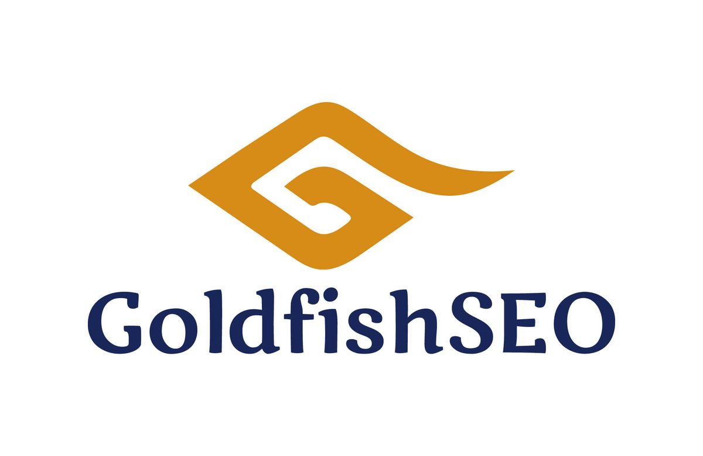

Interview with Antony Bell, Founder of GoldfishSEO
Welcome to the world of digital marketing, where businesses aim to conquer the online realm and maximize their growth potential. In the vibrant city of Bangkok, Thailand, Antony Bell has emerged as a prominent player, providing small and medium-sized companies with powerful SEO strategies, impactful PPC campaigns, and visually stunning website designs. We sat down with Antony Bell, the founder and entrepreneur behind [GoldfishSEO](https://goldfishseo.co.th/), to uncover the motivations, challenges, and triumphs that have shaped his professional journey.

## **Achieving Work-Life Balance: The Entrepreneur's Challenge**

In today's fast-paced [entrepreneurial landscape](/inspire-members/), maintaining a healthy work-life balance is vital. When asked how he manages to strike this delicate equilibrium, Antony Bell shares some valuable insights. "Balancing the demands of running a business and personal life can be challenging," he admits. However, he emphasizes the importance of setting clear boundaries, delegating tasks, and effective time management to create a harmonious blend of work and personal interests.

## **Overcoming Setbacks: Adapting to Evolving Industry**

No journey is without its hurdles, and the digital marketing industry is no exception. Antony Bell candidly reveals a significant challenge he faced: adapting to the ever-evolving trends and updates in search engine algorithms. "Staying ahead of algorithmic changes requires continuous learning and adaptability," he emphasizes. By investing in professional development, attending industry conferences, and fostering a culture of learning within his team, Antony Bell navigated through these setbacks and emerged stronger than ever.

## **Key Skills and Qualities for Success in the Industry**

To succeed in the competitive digital marketing landscape, certain skills and qualities are indispensable. Antony Bell identifies expertise in SEO, SEM, and website design as a foundational skill set. However, he also emphasizes the importance of analytical thinking, adaptability, strong communication and interpersonal skills, as well as leadership and team management. These qualities have played a pivotal role in GoldfishSEO's success in helping their clients achieve remarkable growth.

## **Staying Ahead of the Curve: Adapting to Evolving Trends**

The digital marketing industry is characterized by rapid advancements and ever-evolving trends. When asked how he stays updated, Antony Bell highlights a multi-faceted approach. Continuous learning through industry conferences, webinars, and workshops keeps him well-informed about emerging trends. Additionally, networking and collaboration with industry professionals help him gain insights and stay in tune with the latest developments. Research and experimentation further enable GoldfishSEO to adapt their strategies effectively and embrace the cutting-edge technologies that drive digital success.

*Ideas Idea Vision Design Plan Objective Mission Concept*

## **The Birth of GoldfishSEO: Standing Out from Competitors**

Behind every successful business lies a story of inspiration and vision. Antony Bell reveals the driving force behind the establishment of GoldfishSEO: "We witnessed the transformative power of the online world for businesses, and we wanted to be the reliable partner that empowers small and medium-sized companies to thrive in this digital landscape." What sets GoldfishSEO apart from competitors? Antony Bell emphasizes their personalized approach, tailoring strategies to each client's unique needs, and their dedicated team of professionals who combine expertise with a commitment to ethical practices.

## **Project Spotlight: Transforming a Local E-commerce Store**

[Member Information](/inspire-members/)

One project stands out as a shining achievement for GoldfishSEO. Antony Bell shares the story of a local e-commerce store that had been struggling to generate traffic and convert visitors into customers. Through a comprehensive website redesign and SEO campaign, GoldfishSEO transformed the online presence of the store. The results were remarkable, with a significant increase in organic traffic, search engine rankings, conversions, and ultimately, revenue. This project exemplifies GoldfishSEO's expertise in website design, SEO, and their ability to drive tangible results for their clients.

## **Nurturing Innovation and Creativity: Building a Dynamic Team**

Innovation and creativity are the lifeblood of any successful organization. Antony Bell acknowledges their importance and outlines strategies to foster them within the team. By encouraging open communication, recognizing and rewarding creativity, providing learning and growth opportunities, and allowing room for experimentation, GoldfishSEO cultivates a dynamic team that consistently brings fresh ideas and innovative solutions to the table.

## **Making Tough Decisions: Balancing Priorities**

In the entrepreneurial journey, difficult decisions often arise. Antony Bell shares an instance where he had to make a tough business decision. Faced with the choice of investing in technology infrastructure or allocating funds to marketing and business development initiatives, he carefully weighed the options. Prioritizing long-term benefits, he decided to invest in upgrading the technology infrastructure, recognizing its potential to enhance productivity, efficiency, and overall competitiveness.

## **Customer Satisfaction: Building Long-lasting Relationships**

For GoldfishSEO, customer satisfaction is at the core of their business. Building long-lasting relationships with clients is a priority. To achieve this, GoldfishSEO focuses on understanding client needs, maintaining regular and transparent communication, delivering measurable results, providing exceptional customer service, and continually improving their services. By exceeding client expectations, GoldfishSEO fosters trust, loyalty, and enduring partnerships.

## **Conclusion: GoldfishSEO - Empowering Small Businesses for Digital Success**

As our conversation draws to a close, it becomes evident that Antony Bell and GoldfishSEO are not just another digital marketing agency. They embody the passion and dedication required to empower small and medium-sized businesses to thrive in the digital world. By providing personalized strategies, staying ahead of industry trends, fostering innovation, and ensuring customer satisfaction, GoldfishSEO has established itself as a trusted partner in the digital marketing realm. With Antony Bell's expertise and commitment, GoldfishSEO continues to transform the online presence of businesses, helping them achieve new heights of success in the ever-evolving digital landscape.
