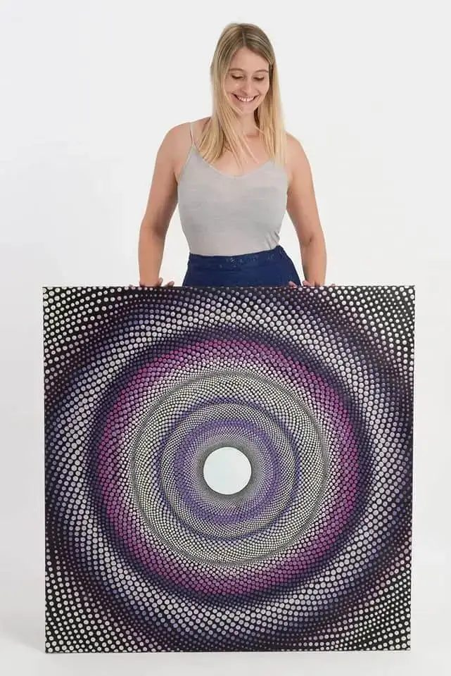
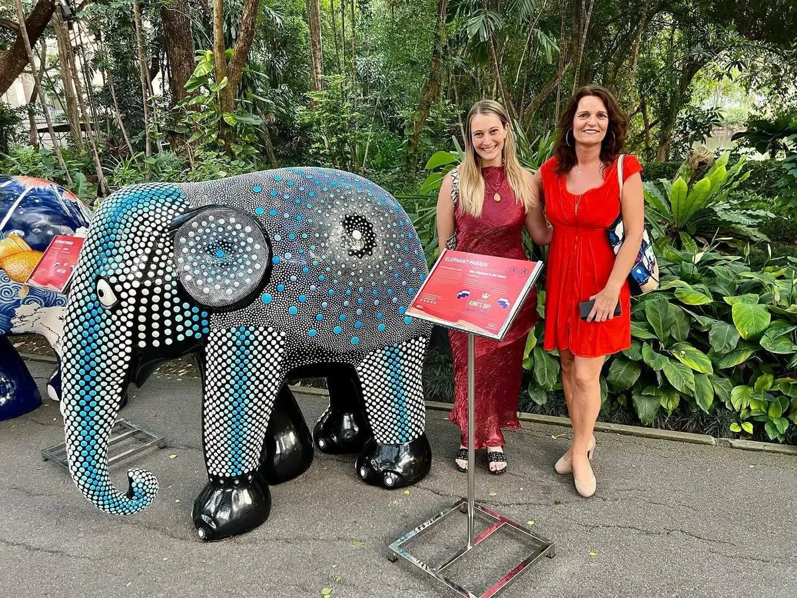
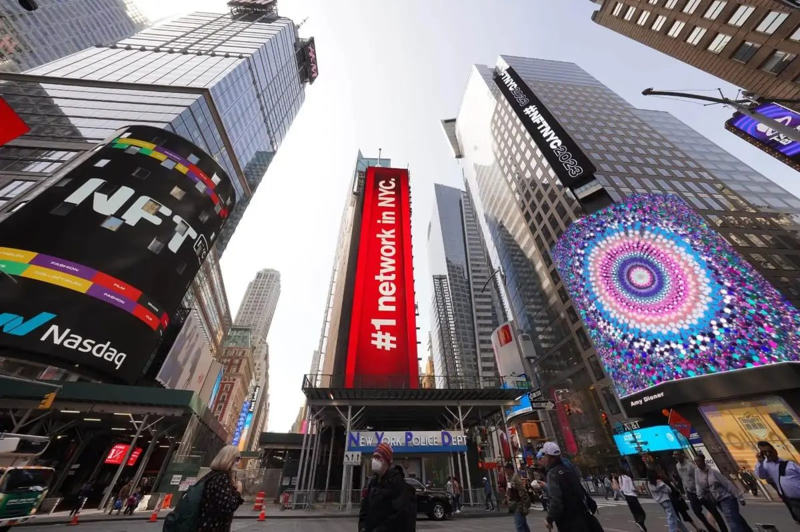
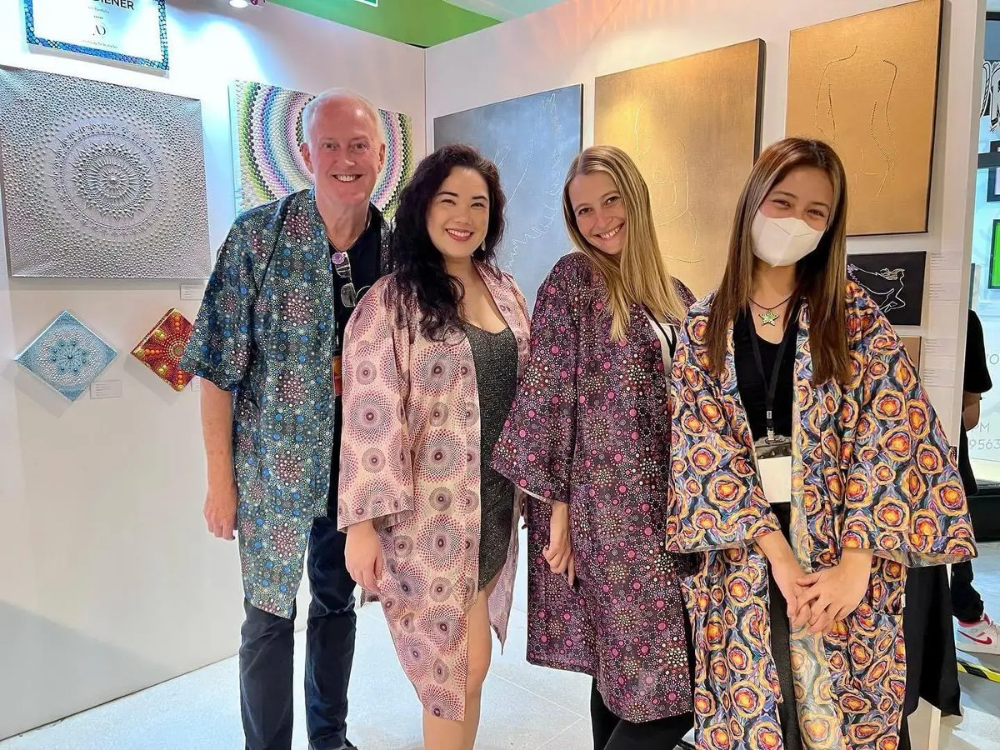

### *Bringing Creativity, Sustainability, and Joy to the Canvas of Business*

In the realm where art and entrepreneurship intersect, a trailblazer emerges, infusing colors of creativity and innovation onto the canvas of business. Meet **Amy Diener**, the visionary artist and entrepreneur who has turned her passion for art into a thriving enterprise. As the founder and artistic force behind **Amy Diener Co. Ltd**, her journey from an art teacher to a prominent figure in the art world is a testament to her resilience, creativity, and commitment to her craft.

Check out Amy's member profile and all the other members on the [iNSPIRE Network](/)

[Inspire members](/)

## **A Brushstroke of Inspiration: Unveiling the Genesis**

Amy's artistic voyage commenced long before she officially founded her company in late 2020. Having embarked on a professional artist's path in 2013 upon her relocation to Bangkok, she initially spent seven fruitful years nurturing young minds as an art teacher at ASB. Yet, as the sands of time trickled through the hourglass, she felt the winds of change rustling within her creative spirit.

"In September 2020, I registered my company, Amy Diener Co. Ltd, as it was a dream of mine to be a full-time artist-entrepreneur," Amy shares. "A human design reading I received a couple of years earlier revealed my destiny as a 'manifester.' This meant I was designed to be my own boss and manifest my dreams into reality."

And manifest, she did. With a fiery passion, Amy embarked on a journey to pursue her art, sell and teach on her own terms, collaborating with brands emphasizing sustainability, and nurturing her community—one dot at a time.

## **Balancing the Palette: Crafting Art and Business Harmoniously**

Amid the strokes of creativity and the intricacies of entrepreneurship, Amy has mastered the art of work-life equilibrium. "I excel at repurposing content, reigning as the queen of efficiency," she quips. By harnessing tools like Chat GPT, she seamlessly maintains relevance while juggling numerous projects. Flexibility is her forte, gracefully adapting to the ever-evolving landscape around her.

## Amy Diener **Conquering Creative Abyss: A Journey of Resilience**

Even luminous careers are not devoid of challenges. For Amy, a significant hurdle emerged in the form of a creative block accompanied by self-doubt. Undeterred, she navigated this labyrinthine phase by embracing self-care and exploring novel sources of inspiration. Collaborating with fellow artists, engaging with art communities, and seeking mentorship rekindled her creative fire. Through this process, she transformed setbacks into stepping stones, revitalizing her creativity and reiterating the importance of self-care and community support.

## **Palette of Success: Blending Key Skills and Qualities**

Amy attributes her success in the art industry to a kaleidoscope of key skills and qualities. Creativity and adaptability shine as her cornerstones, coupled with an entrepreneurial spirit and a penchant for continuous learning. Resilience and perseverance have been her allies in weathering storms, while effective communication has woven a tapestry of strong relationships. This amalgamation has propelled her artistry to new horizons.

## **Navigating the Shifting Horizons: Embracing Evolution**

In the ever-evolving realm of artistry, Amy thrives on research, reading, and engagement with fellow artists via platforms like Instagram. This dynamic approach ensures she remains a harbinger of innovation and stays attuned to the winds of change sweeping across her industry.

## **Mastering the Canvas of Commerce: Crafting a Unique Business Identity**

But what truly sets Amy apart is her duality as both an artist and a business savant. Her fusion of artistic prowess with marketing acumen has birthed a commercial entity out of her creative journey. "I am the only foreign painter and teacher specializing in dot painting under my own company in Thailand," she proudly asserts. Constantly devising new avenues for expansion, Amy's visionary perspective radiates.

## **A Streak of Triumph: Times Square and Beyond**

As the crescendo of Amy's artistic symphony, her artwork "Lupins" earned a spotlight on the billboards of Times Square during NFT NYC in April 2023. The significance of this achievement is palpable—seeing her creation adorned in the heart of Times Square stands as a testament to her dedication and prowess. "There is no greater privilege than seeing your work displayed in such an iconic destination," Amy reflects.

## **Infusing Innovation: Cultivating Creativity Within**

Amy's journey is a testament to her innovation-fueled approach. Within her team, she cultivates an environment that encourages open dialogue, collaboration, and free exchange of ideas. This nurturing culture ignites sparks of innovation and ensures her artistic domain remains dynamic and forward-looking.

## **Brushstrokes of Decision: Navigating Entrepreneurial Crossroads**

Amy's entrepreneurial path encountered a crossroads when contemplating collaboration with an investor. The meticulous decision-making process weighed financial benefits against creative autonomy. Ultimately, she opted to retain sole ownership, valuing creative control and her company's core values above all.

## **Crafting a Canvas of Customer Satisfaction**

For Amy, the customer is at the heart of her creative endeavor. She ensures customer satisfaction by actively engaging with their needs, promptly addressing concerns, and delivering top-tier products and services. By nurturing open communication and a commitment to excellence, she forges enduring client relationships.

As we conclude our journey through the vivid strokes of Amy Diener's artistic odyssey, her story resonates as a harmonious blend of passion, resilience, and business acumen. With each dot she paints and every collaboration she fosters, Amy continues to spread joy, leaving an indelible mark on the canvas of the art world—a mark that is as vibrant and enduring as her spirit.

## **Unlock the Future: Engage with Amy Diener's Artistry**

Amy Diener's artwork resonates with a symphony of colors, each brushstroke telling a story of creativity and joy. To immerse yourself in her world and explore the boundless possibilities of her artistic expression, connect with Amy's creations through the following avenues:

Email: [info@amydiener.com](mailto:info@amydiener.com)  
Website: [www.amydiener.com](http://www.amydiener.com/)  
Tel: [+66863599104](tel:66863599104)

As Amy continues to spread the essence of happiness through her art, her journey is a reminder that passion and dedication can blend to create masterpieces that transcend time.
